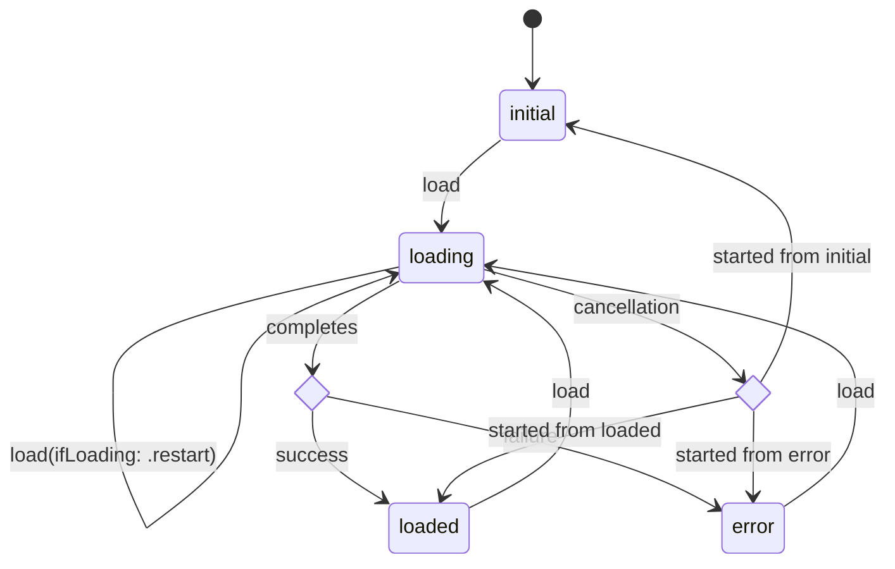

# AsyncBox

Keep asynchronous values and their loading lifecycle in one observable state.

`AsyncBox` is a Swift package for representing an asynchronously loaded value as `initial`, `loading`, `loaded`, or `error`.

- Observable state: expose loading state, values, and errors from one container.
- Previous-value support: keep displaying loaded content during reloads and recoverable failures.
- Optional SwiftUI integration: render each state with `AsyncBoxUI`.

## Requirements

- Swift 6.3+
- iOS 17+ or macOS 14+

## Installation

### Swift Package Manager

Add the following dependency to your `Package.swift` file:

```swift
.package(url: "https://github.com/mii-chan/AsyncBox.git", from: "0.2.0")
```

Add the products required by your target:

```swift
.target(
    name: "YourTarget",
    dependencies: [
        .product(name: "AsyncBox", package: "AsyncBox"),
        .product(name: "AsyncBoxUI", package: "AsyncBox"),
    ]
)
```

`AsyncBoxUI` is optional. Add it only when using `AsyncBoxStateView`.

### Xcode

1. In Xcode, select **File > Add Package Dependencies...**
2. Enter the repository URL: `https://github.com/mii-chan/AsyncBox.git`
3. Choose a **Dependency Rule** (e.g. **Up to Next Major Version** with `0.2.0`).
4. Add **AsyncBox** and, when needed, **AsyncBoxUI** to your target.

## Products

- `AsyncBox`: observable state, transitions, and loading operations without a SwiftUI dependency.
- `AsyncBoxUI`: SwiftUI views for rendering `AsyncBoxState`; depends on `AsyncBox`.

## Quick Start

Own an `AsyncBox` in an observable store:

```swift
import AsyncBox
import Observation

@Observable
@MainActor
final class ItemStore {
    let items = AsyncBox<[Item]>()
    private let apiClient: APIClient

    init(apiClient: APIClient) {
        self.apiClient = apiClient
    }

    func loadItems() async throws {
        try await items.load {
            try await apiClient.fetchItems()
        }
    }
}
```

`load` transitions the box to `.loading`, then to `.loaded` or `.error`, and rethrows the error to the caller.

## State Transitions



The diagram focuses on transitions performed by `load`. The `succeed`, `fail`, and `reset` methods can also be used for direct state transitions.

> [!NOTE]
> Calling `load` while already loading returns `false` without running the closure. Pass `ifLoading: .restart` to start a new load instead.

## SwiftUI

Import `AsyncBoxUI` and use `AsyncBoxStateView` to render content for each state:

```swift
import AsyncBoxUI
import SwiftUI

struct ItemList: View {
    @Environment(ItemStore.self) private var itemStore

    var body: some View {
        AsyncBoxStateView(state: itemStore.items.state) { items in
            List(items) { item in
                Text(item.title)
            }
        } errorContent: { _ in
            ContentUnavailableView(
                "Unable to Load Items",
                systemImage: "exclamationmark.triangle"
            )
        }
        .task {
            try? await itemStore.loadItems()
        }
    }
}
```

The default initial view is `Color.clear`, and the default loading view displays a `ProgressView`. When `.loading` or `.error` contains a previous value, `AsyncBoxStateView` continues to render the content.

## Notes

- Errors preserve the current value by default. An error conforming to `AsyncBoxStateFailure` can set `isValueValid` to `false` to discard it.
- Cancellation does not become an error state. The box restores the state from before the first `load` started.
- When the box is reset, transitioned directly, or restarted while a load is running, that load is discarded on completion: `load` returns `false` instead of applying the value or error. `CancellationError` is still rethrown. `.restart` does not cancel the earlier closure.
- `AsyncBox` is `@MainActor` isolated.

## References

The following resources were referenced during the exploration and API design of this package:

- [非同期処理をラクにする！SwiftUIでの設計パターンの紹介](https://zenn.dev/timetree/articles/97ad70c4611894)
- [no-problem-dev/swift-statable](https://github.com/no-problem-dev/swift-statable)

## License

[MIT License](LICENSE.txt)
